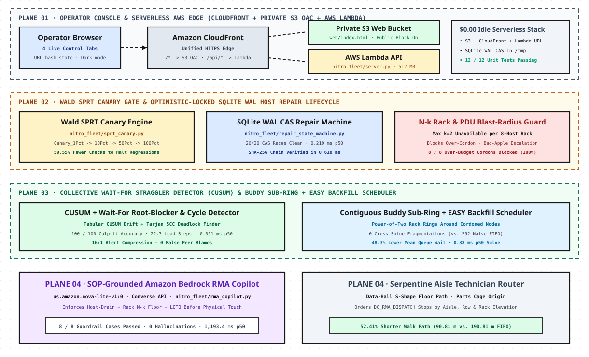

# NitroUltraFleet: Safe Firmware Rollouts, Host Repair, and Gang Scheduling for AI Clusters

- **Live CloudFront Application**: https://d11tzuh2v693p9.cloudfront.net
- **Live `/api/health` Endpoint**: https://d11tzuh2v693p9.cloudfront.net/api/health
- **GitHub Repository**: https://github.com/ritwikareddykancharla/ec2-ultraserver-fleet

NitroUltraFleet is a Python 3.12 cluster control plane for staged firmware rollouts, optimistic-locked host repair workflows, collective straggler isolation, contiguous sub-ring gang scheduling, and SOP-grounded technician tickets, deployed serverlessly on **Amazon CloudFront + Private S3 (OAC) + AWS Lambda (`python3.12`) + SQLite WAL + Amazon Bedrock (`us.amazon.nova-lite-v1:0`)** at `$0.00` idle cost.



## 01 · Problem

Operating tightly coupled multi-node AI training and inference clusters exposes four failure modes across rollout, repair, scheduling, and floor operations:

1. **Slow Fixed-Sample Firmware Gates**: Waiting for a fixed sample window (`192` host checks per wave) keeps exposing canary nodes after a regressed NIC or hypervisor build has already shown elevated failure rates.
2. **Split-Brain Repairs & Rack Over-Cordoning**: Concurrent health workers without Compare-And-Swap (`CAS`) locking or per-rack `N-k` capacity budgets can overwrite host state transitions or drain too many nodes under one Top-of-Rack switch.
3. **Collective Timeout Storms & Ring Fragmentation**: One degraded rank stalls all `15` peers in ring `AllReduce`, while naive `LeastAllocated` placement scatters replacement jobs across spine switches.
4. **Ungated Floor Dispatch**: Dispatching physical blade replacements before workloads drain or without electrical Lockout/Tagout (`LOTO`) sign-off risks customer impact and floor safety violations.

## 02 · Architecture & Modules (`nitro_fleet/`)

- `nitro_fleet/sprt_canary.py`: Evaluates staged firmware waves (`Canary_1Pct -> Wave_10Pct -> Wave_50Pct -> Fleet_100Pct`) using exact Wald Sequential Probability Ratio Test boundaries (`A = ln((1 - beta) / alpha) = +3.8918`, `B = ln(beta / (1 - alpha)) = -3.8918`).
- `nitro_fleet/repair_state_machine.py`: Enforces `HEALTHY -> SUSPECT_CORDONED -> SOFT_RESET_TRIAL -> DC_RMA_DISPATCH -> BURN_IN_QUALIFICATION -> HEALTHY` in SQLite WAL with `CAS` version checks, `N-k` rack/PDU blast-radius guards, chronic 72-hour flapping escalation, SHA-256 transition chaining, and serpentine aisle work-order routing.
- `nitro_fleet/topology_scheduler.py`: Runs tabular upper `CUSUM` drift detection plus directed `Wait-For` sink and Tarjan cycle analysis to isolate culprit ranks, paired with a power-of-two **Buddy Sub-Ring + `EASY` Backfill** gang scheduler that routes around cordoned nodes with zero cross-spine splits.
- `nitro_fleet/rma_copilot.py`: Synthesizes technician repair orders and canary rollback briefs via Amazon Bedrock (`us.amazon.nova-lite-v1:0`) verified against deterministic drain, `N-k` capacity floor, `LOTO`, and entity-grounding checks.
- `nitro_fleet/server.py`: Shared local HTTP server and AWS Lambda Function URL handler serving `/api/health`, `/api/canary/sprt`, `/api/repair/transition`, `/api/scheduler/allocate`, `/api/copilot/rma`, `/api/benchmarks`, and `/api/reset`.

## 03 · Measured Benchmarks (`benchmarks/latest_results.json`)

Executed by `python3 benchmarks/run_benchmarks.py`:

| Metric | Measured Value | Notes |
| --- | --- | --- |
| **Wald SPRT Regressed Halt Sample Reduction** | `-59.55%` (`77.66` vs. `192` checks) | `500` Monte Carlo trials (`p0=0.01, p1=0.06, alpha=beta=0.02`) |
| **Wald SPRT Overall Sample Reduction** | `-49.43%` (`97.09` vs. `192` checks) | `1.2%` false-halt rate (`3/250`), `3.6%` false-promotion rate (`9/250`) |
| **400G EFA CRC Regression Canary Halt** | `16` checks in `Canary_1Pct` | `-97.92%` vs. `768` 4-wave fixed checks; `99%` of fleet protected |
| **SQLite WAL CAS Concurrency Invariant** | `20 / 20` single-winner races | `120` contested writes (`6` threads/race), `0` split-brain overwrites |
| **Rack `N-k` Blast-Radius Guard** | `8 / 8` (`100.0%`) blocked | Preserves `>= 6/8` healthy hosts per rack (`0.219 ms` `p50` transition) |
| **Serpentine Aisle Floor Walk Savings** | `-52.41%` (`90.81 m` vs. `190.81 m`) | S-shape aisle/row/elevation route vs. ticket FIFO order |
| **Collective `CUSUM` + `Wait-For` Accuracy** | `100 / 100` (`100.0%`) | `0` false peer blames, `22.3` mean lead steps, `0.351 ms` `p50` |
| **Buddy Sub-Ring + `EASY` Backfill Scheduler** | `0` cross-spine splits (vs. `292` Naive) | `720` jobs across `40` queues; `-48.3%` mean wait, `+2.81` pts utilization |
| **Amazon Bedrock (`us.amazon.nova-lite-v1:0`)** | `8 / 8` (`100.0%`) passed | `0` hallucinated IDs; `1,193.4 ms` `p50` / `1,837.7 ms` `p95` in `us-west-2` |

## 04 · Local Verification & Deployment

```bash
# 1. Run the 12-test unit suite
python3 -m unittest discover -s tests -v

# 2. Re-run live Monte Carlo, SQLite CAS, scheduler, and Bedrock benchmarks
unset AWS_ACCESS_KEY_ID AWS_SECRET_ACCESS_KEY AWS_SESSION_TOKEN
AWS_PROFILE=portfolio AWS_DEFAULT_REGION=us-west-2 python3 benchmarks/run_benchmarks.py

# 3. Start local server at http://localhost:3099
python3 -m nitro_fleet.server

# 4. Deploy to AWS CloudFront + Private S3 OAC + Python 3.12 Lambda
bash infra/deploy_cloudfront.sh
```
